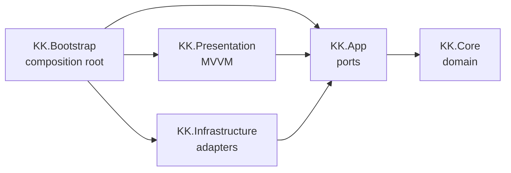
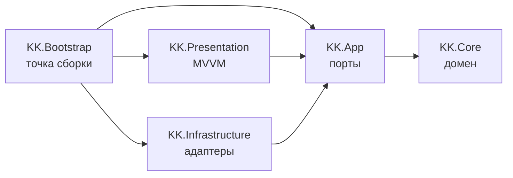

# Keyboard Knights

A typing trainer built in Unity, with a clean layered architecture designed to grow into a full game.


**[English](#english) | [Русский](#russian)**

---

<a id="english"></a>

## Overview

Keyboard Knights is a typing game: the player types a text character by character, and at the end gets their speed, accuracy and number of mistakes. The text comes either from a built-in set or from an article on [kknights.com](https://kknights.com), fetched through the site's JSON API.

The project is at the **MVP stage** (training mode) and targets **WebGL and Windows**. The architecture is designed so that the planned features (site account login, progress saving, leaderboards, multiplayer, combat mechanics) can be added without rewriting the core.

## Demo

<!-- TODO: add a gameplay GIF → docs/images/gameplay.gif
 -->

<!-- TODO: add a link to the playable WebGL build
**[Play in browser](https://...)** -->

## Features

- **Blocking input model**: the cursor waits for the correct character, there is no Backspace, and every wrong keystroke counts as a separate mistake.
- **Live progress highlighting**: typed and untyped parts of the text are rendered differently using TextMeshPro rich-text tags.
- **Statistics**: characters per minute, accuracy and number of mistakes. The timer starts at the first keystroke, so reading the text before starting doesn't lower the speed.
- **Full keystroke log**: every keystroke (position, expected and typed character, timestamp) is recorded, which makes detailed analytics and replays possible later.
- **Text sources**: a predefined text, or an article from kknights.com loaded through the site's API. The source is selected in the Inspector.
- **Site content parser** that supports both formats of the site's editor: HTML blocks and a ProseMirror/TipTap document tree.
- **Text normalization**: typographic quotes, dashes and ellipses are converted to ASCII; line breaks become spaces; untypeable characters are removed; `ё → е` is optional.
- **Keyboard hot-plug**: input survives the keyboard being disconnected and reconnected.

## Tech Stack

| Technology | Why it's used |
|---|---|
| **Unity 6** (6000.6), **URP 2D** | Engine and rendering, one codebase for WebGL and Windows |
| **C#**, assembly definitions | Code split into layer assemblies; the compiler enforces dependency direction |
| **UniTask** | Allocation-free async/await integrated into the Unity PlayerLoop; works on WebGL where threads aren't available |
| **R3** | Reactive properties for ViewModel → View binding |
| **Input System** | Text input through `Keyboard.onTextInput`, which respects the OS keyboard layout |
| **TextMeshPro** | Text rendering with rich-text highlighting of progress |
| **Newtonsoft.Json** | Parsing the kknights.com API responses |
| **Unity Test Framework** | Connected for the upcoming domain unit tests |

## Architecture

The code follows **Clean Architecture**: it is split into assembly definitions (asmdef), one per layer. Dependencies point inwards, toward the domain.



*An arrow means "references". `KK.Core` is also referenced directly by every outer layer.*

| Layer | Responsibility | Rules |
|---|---|---|
| `KK.Core` | Domain: typing session, keystroke log, statistics, text normalization | No Unity references (`noEngineReferences: true`), synchronous pure C# |
| `KK.App` | Ports: `ITypingTextProvider`, `ITypingInput`, `IClock` | No Unity API |
| `KK.Infrastructure` | Port implementations: text providers, site API parser, input handler, clock | Doesn't know about Presentation |
| `KK.Presentation` | `TypingViewModel` and `TypingView` (MVVM) | Doesn't know about Infrastructure |
| `KK.Bootstrap` | Composition root: `TypingFacade` and `TypingTextProviderFactory` | The only assembly that knows all the others |

**Execution flow.** `TypingFacade` gets a text provider from the factory and awaits the text, cancelling the load if the object is destroyed. It normalizes the text, wires the input handler, clock, `TypingSession` and `TypingViewModel` together, and binds the view. When the session completes, the ViewModel raises `Completed` with a `TypingResult`.

## Key Design Decisions

- **Layered asmdef assemblies instead of a single project.** Dependency rules are enforced by the compiler rather than by convention: the domain physically can't reference `UnityEngine`. This keeps the core testable and makes it possible to reuse it later on a server for multiplayer.
- **Ports live in the layer that uses them.** Interfaces such as `ITypingTextProvider` are declared in `KK.App`, and implementations live in `KK.Infrastructure`. A new text source (e.g. a random article from the site) is a new class plus one factory branch; no changes to the core are needed.
- **The domain doesn't know about time.** `TypingSession.TryType` receives the timestamp as a parameter from an `IClock` port. The domain stays deterministic, and statistics can be tested without waiting for real time.
- **A keystroke log instead of counters.** The session stores every keystroke, and `StatsCalculator` derives all metrics from the log. New metrics (per-key errors, speed over time) can be added without changing the input logic.
- **Strict normalization for blocking input.** With blocking input, a character the player can't type would stop them forever. So the text goes through a whitelist (printable ASCII, Cyrillic, `№`) after typographic characters are replaced.
- **UniTask with cancellation tokens instead of coroutines.** Loading is cancelled through `destroyCancellationToken`. Cancellation is treated as a normal case and isn't logged as an error, and other exceptions are logged without crashing the scene. UniTask also runs on WebGL, which has no threads.
- **Explicit resource ownership.** Whoever creates an object disposes of it: the facade disposes of the ViewModel, then the input. Subscriptions to long-lived publishers (`Keyboard`, static `InputSystem` events) are removed in `Dispose()`, not left to the finalizer, to avoid leaks between sessions.
- **WebGL constraints are designed in up front.** No `Task.Run`, `Task.Delay` or `ConfigureAwait(false)`. Networking is being migrated from `HttpClient`, which doesn't work in the browser, to `UnityWebRequest`.

## Project Structure

```
Assets/Scripts/
├── Core/             KK.Core — domain
│   ├── Typing/       TypingSession, Keystroke, StatsCalculator, TypingResult
│   └── Texts/        TextNormalizer, TextNormalizationOptions
├── App/              KK.App — ports
│   ├── Texts/        ITypingTextProvider
│   ├── Typing/       ITypingInput
│   └── Timing/       IClock
├── Infrastructure/   KK.Infrastructure — adapters
│   ├── Texts/        PredefinedTextProvider, KKnights/ (API parser, URL provider)
│   ├── Input/        TextInputHandler
│   └── Timing/       UnityClock
├── Presentation/     KK.Presentation — TypingViewModel, TypingView
└── Bootstrap/        KK.Bootstrap — TypingFacade, provider factory, custom editor
```

## Getting Started

**Requirements:** Unity **6000.6.4f1**.

1. Clone the repository and open the folder in Unity Hub. Packages are restored automatically; UniTask and R3 come from the OpenUPM scoped registry.
2. Open the `Assets/Scenes/SampleScene.unity` scene.
3. On the `TypingTextProviderFactory` component, select a text source: a predefined text, or a kknights.com API URL.
4. Press **Play** and start typing.

> The article-by-URL mode currently uses `HttpClient` and works in the Editor and on Windows. WebGL support for it is pending the migration to `UnityWebRequest`.

## Author

**artshest**

<!-- TODO: add contacts
- GitHub: https://github.com/...
- Telegram / Email / LinkedIn: ... -->

## License

This project is licensed under the [MIT License](LICENSE).

---

<a id="russian"></a>

## Обзор

Keyboard Knights — игра-тренажёр слепой печати: игрок посимвольно набирает текст, а в конце получает скорость, точность и число ошибок. Текст берётся из встроенного набора или из статьи сайта [kknights.com](https://kknights.com) через его JSON API.

Проект находится на **стадии MVP** (режим тренировки), целевые платформы — **WebGL и Windows**. Архитектура рассчитана на то, чтобы запланированные возможности (вход через аккаунт сайта, сохранение прогресса, лидерборды, мультиплеер, боевая механика) добавлялись без переделки ядра.

## Демо

<!-- TODO: добавить GIF геймплея → docs/images/gameplay.gif
 -->

<!-- TODO: добавить ссылку на играбельную WebGL-сборку
**[Играть в браузере](https://...)** -->

## Возможности

- **Блокирующий ввод**: курсор ждёт правильный символ, Backspace нет, каждое неверное нажатие считается отдельной ошибкой.
- **Подсветка прогресса**: набранная и ненабранная части текста отображаются по-разному через rich-text теги TextMeshPro.
- **Статистика**: знаки в минуту, точность и число ошибок. Время отсчитывается от первого нажатия, поэтому чтение текста перед стартом не снижает скорость.
- **Полный журнал нажатий**: записывается каждое нажатие (позиция, ожидаемый и введённый символ, время). Это задел для детальной аналитики и повторов.
- **Источники текста**: заранее заданный текст или статья с kknights.com, загружаемая через API сайта. Источник выбирается в инспекторе.
- **Парсер контента сайта**, поддерживающий оба формата редактора: HTML-блоки и дерево документа ProseMirror/TipTap.
- **Нормализация текста**: типографские кавычки, тире и многоточия приводятся к ASCII, переводы строк становятся пробелами, ненабираемые символы удаляются, замена `ё → е` опциональна.
- **Переподключение клавиатуры**: ввод продолжает работать после отключения и повторного подключения клавиатуры.

## Стек технологий

| Технология | Зачем используется |
|---|---|
| **Unity 6** (6000.6), **URP 2D** | Движок и рендеринг, одна кодовая база для WebGL и Windows |
| **C#**, assembly definitions | Код разделён на сборки по слоям; направление зависимостей проверяет компилятор |
| **UniTask** | async/await без аллокаций, встроенный в PlayerLoop Unity; работает в WebGL, где нет потоков |
| **R3** | Реактивные свойства для связки ViewModel → View |
| **Input System** | Ввод текста через `Keyboard.onTextInput` с учётом раскладки ОС |
| **TextMeshPro** | Рендеринг текста с rich-text подсветкой прогресса |
| **Newtonsoft.Json** | Разбор ответов API kknights.com |
| **Unity Test Framework** | Подключён для будущих unit-тестов домена |

## Архитектура

Код построен по принципам **Clean Architecture** и разделён на сборки (asmdef), по одной на слой. Зависимости направлены внутрь, к домену.



*Стрелка означает «ссылается на». На `KK.Core` напрямую ссылаются также все внешние слои.*

| Слой | Ответственность | Правила |
|---|---|---|
| `KK.Core` | Домен: сессия набора, журнал нажатий, статистика, нормализация текста | Без ссылок на Unity (`noEngineReferences: true`), синхронный чистый C# |
| `KK.App` | Порты: `ITypingTextProvider`, `ITypingInput`, `IClock` | Без Unity API |
| `KK.Infrastructure` | Реализации портов: провайдеры текста, парсер API сайта, обработчик ввода, часы | Не знает о Presentation |
| `KK.Presentation` | `TypingViewModel` и `TypingView` (MVVM) | Не знает об Infrastructure |
| `KK.Bootstrap` | Composition root: `TypingFacade` и `TypingTextProviderFactory` | Единственная сборка, знающая все остальные |

**Поток выполнения.** `TypingFacade` получает провайдер текста из фабрики и ждёт текст. Если объект уничтожен, загрузка отменяется. Затем фасад нормализует текст, связывает обработчик ввода, часы, `TypingSession` и `TypingViewModel` и привязывает View. Когда сессия завершается, ViewModel вызывает событие `Completed` с `TypingResult`.

## Ключевые решения

- **Слоистые asmdef-сборки вместо одного проекта.** Правила зависимостей обеспечивает компилятор, а не договорённость: домен физически не может сослаться на `UnityEngine`. Поэтому ядро остаётся тестируемым, и его можно будет переиспользовать на сервере для мультиплеера.
- **Порты лежат в слое, который их использует.** Интерфейсы вроде `ITypingTextProvider` объявлены в `KK.App`, а реализации находятся в `KK.Infrastructure`. Новый источник текста (например, случайная статья с сайта) — это новый класс и одна ветка в фабрике, ядро менять не нужно.
- **Домен не знает о времени.** `TypingSession.TryType` получает время нажатия параметром из порта `IClock`. Домен остаётся детерминированным, а статистику можно тестировать без ожидания реального времени.
- **Журнал нажатий вместо счётчиков.** Сессия хранит каждое нажатие, и `StatsCalculator` выводит все метрики из журнала. Новые метрики (ошибки по клавишам, скорость во времени) добавляются без изменения логики ввода.
- **Строгая нормализация под блокирующий ввод.** При блокирующем вводе символ, который игрок не может набрать, остановил бы его навсегда. Поэтому после замены типографских символов текст проходит белый список: печатные ASCII, кириллица и `№`.
- **UniTask с токенами отмены вместо корутин.** Загрузка отменяется через `destroyCancellationToken`. Отмена считается штатной ситуацией и не логируется как ошибка, а остальные исключения логируются без падения сцены. Кроме того, UniTask работает в WebGL, где нет потоков.
- **Явное владение ресурсами.** Кто создал объект, тот его и освобождает: фасад освобождает ViewModel, затем ввод. Подписки на долгоживущие издатели (`Keyboard`, статические события `InputSystem`) снимаются в `Dispose()`, а не оставляются финализатору, чтобы не было утечек между сессиями.
- **Ограничения WebGL учтены заранее.** Никаких `Task.Run`, `Task.Delay` и `ConfigureAwait(false)`. Сетевой код переводится с `HttpClient`, который не работает в браузере, на `UnityWebRequest`.

## Структура проекта

```
Assets/Scripts/
├── Core/             KK.Core — домен
│   ├── Typing/       TypingSession, Keystroke, StatsCalculator, TypingResult
│   └── Texts/        TextNormalizer, TextNormalizationOptions
├── App/              KK.App — порты
│   ├── Texts/        ITypingTextProvider
│   ├── Typing/       ITypingInput
│   └── Timing/       IClock
├── Infrastructure/   KK.Infrastructure — адаптеры
│   ├── Texts/        PredefinedTextProvider, KKnights/ (парсер API, URL-провайдер)
│   ├── Input/        TextInputHandler
│   └── Timing/       UnityClock
├── Presentation/     KK.Presentation — TypingViewModel, TypingView
└── Bootstrap/        KK.Bootstrap — TypingFacade, фабрика провайдеров, кастомный редактор
```

## Запуск

**Требования:** Unity **6000.6.4f1**.

1. Клонируйте репозиторий и откройте папку через Unity Hub. Пакеты восстановятся автоматически, UniTask и R3 подтягиваются из scoped registry OpenUPM.
2. Откройте сцену `Assets/Scenes/SampleScene.unity`.
3. В компоненте `TypingTextProviderFactory` выберите источник текста: заранее заданный текст или URL API kknights.com.
4. Нажмите **Play** и начинайте печатать.

> Режим статьи по URL пока использует `HttpClient` и работает в редакторе и на Windows. Поддержка этого режима в WebGL появится после перехода на `UnityWebRequest`.

## Автор

**artshest**

<!-- TODO: добавить контакты
- GitHub: https://github.com/...
- Telegram / Email / LinkedIn: ... -->

## Лицензия

Проект распространяется по лицензии [MIT](LICENSE).
