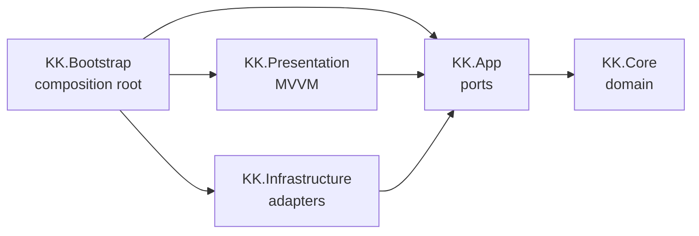
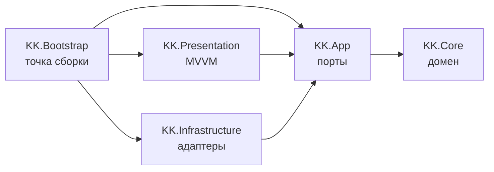

# Keyboard Knights

A typing trainer built in Unity, with a clean layered architecture designed to grow into a full game.


**[English](#english) | [Русский](#russian)**

---

<a id="english"></a>

## Overview

Keyboard Knights is a typing game: the player types a text character by character, and at the end gets their speed, accuracy and number of mistakes. The text comes from a built-in library or from an article on [kknights.com](https://kknights.com), fetched through the site's JSON API.

The project is at the **MVP stage** (training mode) and targets **WebGL and Windows**. The architecture is designed so that the planned features (site account login, progress saving, leaderboards, multiplayer, combat mechanics) can be added without rewriting the core.

## Demo

<!-- TODO: add a gameplay GIF → docs/images/gameplay.gif
 -->

<!-- TODO: add a link to the playable WebGL build
**[Play in browser](https://...)** -->

## Features

- **Blocking input model**: the cursor waits for the correct character, there is no Backspace, and every wrong keystroke counts as a separate mistake.
- **Progress and mistake highlighting**: the typed part, the current character (underlined) and the rest of the text are rendered differently; a mistake turns the current character red with a background, so a mistake on a space is visible too.
- **Live statistics**: characters per minute, accuracy and number of mistakes update while typing, and the speed keeps changing even between keystrokes. The timer starts at the first keystroke, so reading the text before starting doesn't lower the speed.
- **Results screen** with two actions: **Retry** the same text or get **Another text** from the current source.
- **Text sources**, selected in the Inspector: a built-in library (`ScriptableObject`, random text without repeating the previous one), an article from kknights.com by its regular public link, or a fixed debug string.
- **Article fragments made of whole paragraphs**: a random starting paragraph, then its neighbours until the fragment reaches the configured length (300–600 characters by default); sentences are never cut in the middle.
- **Loading screen with error handling**: "Loading..." while the text is being fetched; on failure, a player-friendly message for the specific reason (no connection, article not found, timeout, unknown response format) and a **Retry** button. Requests time out after 15 seconds.
- **Site content parser** that supports both formats of the site's editor: HTML blocks and a ProseMirror/TipTap document tree.
- **Text normalization**: decomposed Unicode letters are composed (NFC), typographic quotes, dashes and ellipses are converted to ASCII; line breaks become spaces; untypeable characters are removed; `ё → е` is optional.
- **Full keystroke log**: every keystroke (position, expected and typed character, timestamp) is recorded, which makes detailed analytics and replays possible later.
- **Keyboard hot-plug**: input survives the keyboard being disconnected and reconnected; if the active keyboard is removed while another one is connected, input switches to it.
- **Unit tests** for all layers except the composition root: domain, fragment selection, article link parsing, site post parser, network loaders and timeout, keyboard input, text library, ViewModel, formatters and real TextMeshPro rendering (Unity Test Framework, EditMode).

## Tech Stack

| Technology | Why it's used |
|---|---|
| **Unity 6** (6000.6), **URP 2D** | Engine and rendering, one codebase for WebGL and Windows |
| **C#**, assembly definitions | Code split into layer assemblies; the compiler enforces dependency direction |
| **UniTask** | Allocation-free async/await integrated into the Unity PlayerLoop; works on WebGL where threads aren't available |
| **R3** | Reactive properties for ViewModel → View binding |
| **Input System** | Text input through `Keyboard.onTextInput`, which respects the OS keyboard layout |
| **TextMeshPro** | Text rendering with rich-text highlighting; a static Noto Sans atlas with Cyrillic |
| **UnityWebRequest** / **HttpClient** | Loading articles: the first one in the browser, the second one in the Editor and on Windows (see the decisions below) |
| **Newtonsoft.Json** | Parsing the kknights.com API responses |
| **Unity Test Framework** (NUnit) | EditMode tests; `InputTestFixture` from Input System emulates keyboards |

## Architecture

The code follows **Clean Architecture**: it is split into assembly definitions (asmdef), one per layer. Dependencies point inwards, toward the domain.



*An arrow means "references". `KK.Core` is also referenced directly by every outer layer.*

| Layer | Responsibility | Rules |
|---|---|---|
| `KK.Core` | Domain: typing session, keystroke log, statistics, text normalization, article fragment selection | No Unity references (`noEngineReferences: true`), synchronous pure C# |
| `KK.App` | Ports: `ITypingTextProvider` (with `TextLoadException` as part of its contract), `ITypingInput`, `IClock` | No Unity API |
| `KK.Infrastructure` | Port implementations: text providers, text library, article link and site API parsers, network loaders with a timeout, input handler, clock | Doesn't know about Presentation |
| `KK.Presentation` | MVVM: `TypingViewModel`, `TypingView`, `ResultsView`, `LoadStatusView` and their formatters | Doesn't know about Infrastructure |
| `KK.Bootstrap` | Composition root: `TypingFacade` and `TypingTextProviderFactory` | The only assembly that knows all the others |

**Execution flow.** `TypingFacade` gets a text provider from the factory and awaits the text, cancelling the load if the object is destroyed; meanwhile `LoadStatusView` shows the loading status, and on a `TextLoadException` it shows the reason and a **Retry** button. Then the facade normalizes the text, wires the input handler, clock, `TypingSession` and `TypingViewModel` together, and binds the view; every frame it calls `TypingViewModel.Tick()` to refresh the statistics. When the session completes, the facade shows `ResultsView`; its buttons end the current session and start a new one with the same text or with a new text from the provider.

## Key Design Decisions

- **Layered asmdef assemblies instead of a single project.** Dependency rules are enforced by the compiler rather than by convention: the domain physically can't reference `UnityEngine`. This keeps the core testable and makes it possible to reuse it later on a server for multiplayer.
- **Ports live in the layer that uses them.** Interfaces such as `ITypingTextProvider` are declared in `KK.App`, and implementations live in `KK.Infrastructure`. The text library was added exactly this way: a new class plus one factory branch, with no changes to the core.
- **The domain doesn't know about time.** `TypingSession.TryType` receives the timestamp as a parameter from an `IClock` port. The domain stays deterministic, and statistics can be tested without waiting for real time.
- **A keystroke log instead of counters.** The session stores every keystroke, and `StatsCalculator` derives all metrics from the log. New metrics (per-key errors, speed over time) can be added without changing the input logic.
- **Network loading behind `IWebTextLoader`, chosen per platform.** kknights.com accepts only TLS 1.3, which Unity's own TLS stack doesn't support, so `UnityWebRequest` fails in the Editor and on Windows; there `HttpClient` is used. In WebGL, `HttpClient` has no sockets, but the browser does the handshake itself, so `UnityWebRequest` works. The factory picks the implementation, and the article provider doesn't know which one it got.
- **Load errors are part of the port contract.** `ITypingTextProvider` throws a `TextLoadException` with a reason (`Network`, `NotFound`, `Timeout`, `BadFormat`): each loader translates its own exceptions (`HttpRequestException`, `UnityWebRequestException`, HTTP 404) into it, so the facade and the UI don't depend on the network technology. Expected failures are logged as warnings; anything else is logged as an exception and shown as a generic message.
- **Timeout as a decorator.** `TimeoutWebTextLoader` wraps any `IWebTextLoader` and uses a realtime timer (independent of `timeScale`). It distinguishes its own timeout from an external cancellation, so destroying the scene isn't reported to the player as a timeout. The built-in `HttpClient` timeout is disabled because it throws an exception indistinguishable from cancellation.
- **Fragment selection in the domain.** `TextFragmentSelector` lives in `KK.Core` and receives `System.Random` from outside, so the rule "only whole paragraphs, within the min–max length" is tested deterministically without the network. The provider only downloads and parses the article.
- **Statistics are refreshed from `Update`, not by an R3 timer.** Without the `R3.Unity` integration, R3 timers run on threads, which WebGL doesn't have. A `Tick()` method called by the facade keeps the ViewModel engine-independent and lets tests drive time through a fake clock.
- **Strict normalization for blocking input.** With blocking input, a character the player can't type would stop them forever. So the text goes through a whitelist (printable ASCII, Cyrillic, `№`) after typographic characters are replaced.
- **Rendering matched to the whitelist.** The font is a static TMP atlas containing exactly the whitelisted characters, so there are no missing glyphs and no runtime atlas growth; a test fails if the whitelist and the atlas diverge. The formatter escapes the text from TMP markup (`<` and `\uXXXX` sequences), which is verified on a real `TextMeshPro` component.
- **UniTask with cancellation tokens instead of coroutines.** Loading is cancelled through `destroyCancellationToken`. Cancellation is treated as a normal case and isn't logged as an error. There are no `Task.Run`/`Task.Delay` calls, since WebGL has no threads.
- **Explicit resource ownership.** Whoever creates an object disposes of it: the facade disposes of the ViewModel, then the input; the factory disposes of the provider and the network loader it created. Subscriptions to long-lived publishers (`Keyboard`, static `InputSystem` events) are removed in `Dispose()`, not left to the finalizer.
- **Tests mirror the layers.** Each tested layer has its own Editor-only test assembly. The parser and the article provider are tested on saved real responses from the site API (JSON fixtures) with a fake loader, `HttpClientTextLoader` on a fake `HttpMessageHandler`, `TextInputHandler` on virtual keyboards via `InputTestFixture`, and the ViewModel on fake input and clock.

## Project Structure

```
Assets/Scripts/
├── Core/             KK.Core — domain
│   ├── Typing/       TypingSession, Keystroke, StatsCalculator, TypingResult
│   └── Texts/        TextNormalizer, TextFragmentSelector and their options
├── App/              KK.App — ports
│   ├── Texts/        ITypingTextProvider, TextLoadException
│   ├── Typing/       ITypingInput
│   └── Timing/       IClock
├── Infrastructure/   KK.Infrastructure — adapters
│   ├── Texts/        Predefined/Random providers, TextLibrary, KKnights/ (link and API parsers, article provider)
│   ├── Web/          IWebTextLoader, UnityWebRequestTextLoader, HttpClientTextLoader, TimeoutWebTextLoader
│   ├── Input/        TextInputHandler
│   └── Timing/       UnityClock
├── Presentation/     KK.Presentation
│   ├── Typing/       TypingViewModel, TypingView, TypingTextFormatter
│   ├── Results/      ResultsView, ResultsFormatter
│   └── Loading/      LoadStatusView, LoadErrorFormatter
└── Bootstrap/        KK.Bootstrap — TypingFacade, provider factory, custom editor

Assets/Texts/TextLibrary.asset   built-in text library
Assets/Fonts/NotoSans/           static TMP font atlas

Assets/Tests/
├── KK.Core.Tests/            TypingSession, StatsCalculator, Keystroke, TypingResult, TextNormalizer, TextFragmentSelector
├── KK.Infrastructure.Tests/  article link, post parser and provider (JSON fixtures), HTTP loader, timeout, input, text library
└── KK.Presentation.Tests/    TypingViewModel (fakes), formatters, font atlas, TMP rendering
```

## Getting Started

**Requirements:** Unity **6000.6.4f1**.

1. Clone the repository and open the folder in Unity Hub. Packages are restored automatically; UniTask and R3 come from the OpenUPM scoped registry.
2. Open the `Assets/Scenes/SampleScene.unity` scene.
3. On the `TypingTextProviderFactory` component, select a text source: the text library, a link to a kknights.com article (e.g. `https://kknights.com/posts/<slug>`), or a fixed text. For articles, the fragment length and the request timeout are configured there too.
4. Press **Play** and start typing.

**Tests:** open **Window → General → Test Runner**, the **EditMode** tab, and press **Run All**. Or from the command line:

```
Unity.exe -batchmode -projectPath . -runTests -testPlatform EditMode -testResults results.xml
```

> In a WebGL build, loading articles from kknights.com additionally requires CORS headers on the site's side.

## Author

**artshest**

<!-- TODO: add contacts
- GitHub: https://github.com/...
- Telegram / Email / LinkedIn: ... -->

## License

This project is licensed under the [MIT License](LICENSE).

---

<a id="russian"></a>

## Обзор

Keyboard Knights — игра-тренажёр слепой печати: игрок посимвольно набирает текст, а в конце получает скорость, точность и число ошибок. Текст берётся из встроенной библиотеки или из статьи сайта [kknights.com](https://kknights.com) через его JSON API.

Проект находится на **стадии MVP** (режим тренировки), целевые платформы — **WebGL и Windows**. Архитектура рассчитана на то, чтобы запланированные возможности (вход через аккаунт сайта, сохранение прогресса, лидерборды, мультиплеер, боевая механика) добавлялись без переделки ядра.

## Демо

<!-- TODO: добавить GIF геймплея → docs/images/gameplay.gif
 -->

<!-- TODO: добавить ссылку на играбельную WebGL-сборку
**[Играть в браузере](https://...)** -->

## Возможности

- **Блокирующий ввод**: курсор ждёт правильный символ, Backspace нет, каждое неверное нажатие считается отдельной ошибкой.
- **Подсветка прогресса и ошибок**: набранная часть, текущий символ (подчёркнут) и остаток текста отображаются по-разному; при ошибке текущий символ становится красным с фоном, поэтому видна и ошибка на пробеле.
- **Живая статистика**: знаки в минуту, точность и число ошибок обновляются во время набора, а скорость меняется и между нажатиями. Время отсчитывается от первого нажатия, поэтому чтение текста перед стартом не снижает скорость.
- **Экран результатов** с двумя действиями: **«Ещё раз»** — тот же текст, **«Другой текст»** — новый текст из текущего источника.
- **Источники текста**, выбираются в инспекторе: встроенная библиотека (`ScriptableObject`, случайный текст без повтора предыдущего), статья с kknights.com по обычной публичной ссылке или фиксированная строка для отладки.
- **Фрагмент статьи из целых абзацев**: случайный начальный абзац, затем соседние, пока фрагмент не наберёт заданную длину (по умолчанию 300–600 символов); предложения никогда не обрезаются посередине.
- **Экран загрузки с обработкой ошибок**: «Загрузка текста...», пока текст скачивается; при сбое — понятное игроку сообщение о конкретной причине (нет связи, статья не найдена, таймаут, незнакомый формат ответа) и кнопка **«Повторить»**. Таймаут запроса — 15 секунд.
- **Парсер контента сайта**, поддерживающий оба формата редактора: HTML-блоки и дерево документа ProseMirror/TipTap.
- **Нормализация текста**: разложенные Unicode-буквы собираются (NFC), типографские кавычки, тире и многоточия приводятся к ASCII, переводы строк становятся пробелами, ненабираемые символы удаляются, замена `ё → е` опциональна.
- **Полный журнал нажатий**: записывается каждое нажатие (позиция, ожидаемый и введённый символ, время). Это задел для детальной аналитики и повторов.
- **Переподключение клавиатуры**: ввод продолжает работать после отключения и повторного подключения клавиатуры; если активную клавиатуру отключили, а подключена другая, ввод переключается на неё.
- **Unit-тесты** всех слоёв, кроме composition root: домен, выбор фрагмента, разбор ссылки на статью, парсер постов сайта, сетевые загрузчики и таймаут, ввод с клавиатуры, библиотека текстов, ViewModel, форматтеры и рендеринг на настоящем TextMeshPro (Unity Test Framework, EditMode).

## Стек технологий

| Технология | Зачем используется |
|---|---|
| **Unity 6** (6000.6), **URP 2D** | Движок и рендеринг, одна кодовая база для WebGL и Windows |
| **C#**, assembly definitions | Код разделён на сборки по слоям; направление зависимостей проверяет компилятор |
| **UniTask** | async/await без аллокаций, встроенный в PlayerLoop Unity; работает в WebGL, где нет потоков |
| **R3** | Реактивные свойства для связки ViewModel → View |
| **Input System** | Ввод текста через `Keyboard.onTextInput` с учётом раскладки ОС |
| **TextMeshPro** | Рендеринг текста с rich-text подсветкой; статический атлас Noto Sans с кириллицей |
| **UnityWebRequest** / **HttpClient** | Загрузка статей: первый — в браузере, второй — в редакторе и на Windows (см. решения ниже) |
| **Newtonsoft.Json** | Разбор ответов API kknights.com |
| **Unity Test Framework** (NUnit) | EditMode-тесты; `InputTestFixture` из Input System эмулирует клавиатуры |

## Архитектура

Код построен по принципам **Clean Architecture** и разделён на сборки (asmdef), по одной на слой. Зависимости направлены внутрь, к домену.



*Стрелка означает «ссылается на». На `KK.Core` напрямую ссылаются также все внешние слои.*

| Слой | Ответственность | Правила |
|---|---|---|
| `KK.Core` | Домен: сессия набора, журнал нажатий, статистика, нормализация текста, выбор фрагмента статьи | Без ссылок на Unity (`noEngineReferences: true`), синхронный чистый C# |
| `KK.App` | Порты: `ITypingTextProvider` (вместе с `TextLoadException` как частью контракта), `ITypingInput`, `IClock` | Без Unity API |
| `KK.Infrastructure` | Реализации портов: провайдеры текста, библиотека текстов, разбор ссылки на статью и парсер API сайта, сетевые загрузчики с таймаутом, обработчик ввода, часы | Не знает о Presentation |
| `KK.Presentation` | MVVM: `TypingViewModel`, `TypingView`, `ResultsView`, `LoadStatusView` и их форматтеры | Не знает об Infrastructure |
| `KK.Bootstrap` | Composition root: `TypingFacade` и `TypingTextProviderFactory` | Единственная сборка, знающая все остальные |

**Поток выполнения.** `TypingFacade` получает провайдер текста из фабрики и ждёт текст. Если объект уничтожен, загрузка отменяется. Пока текст грузится, `LoadStatusView` показывает статус, а при `TextLoadException` — причину и кнопку **«Повторить»**. Затем фасад нормализует текст, связывает обработчик ввода, часы, `TypingSession` и `TypingViewModel`, привязывает View и каждый кадр вызывает `TypingViewModel.Tick()` для пересчёта статистики. Когда сессия завершается, фасад показывает `ResultsView`; его кнопки завершают текущую сессию и запускают новую — с тем же текстом или с новым текстом от провайдера.

## Ключевые решения

- **Слоистые asmdef-сборки вместо одного проекта.** Правила зависимостей обеспечивает компилятор, а не договорённость: домен физически не может сослаться на `UnityEngine`. Поэтому ядро остаётся тестируемым, и его можно будет переиспользовать на сервере для мультиплеера.
- **Порты лежат в слое, который их использует.** Интерфейсы вроде `ITypingTextProvider` объявлены в `KK.App`, а реализации находятся в `KK.Infrastructure`. Именно так добавилась библиотека текстов: новый класс и одна ветка в фабрике, ядро не менялось.
- **Домен не знает о времени.** `TypingSession.TryType` получает время нажатия параметром из порта `IClock`. Домен остаётся детерминированным, а статистику можно тестировать без ожидания реального времени.
- **Журнал нажатий вместо счётчиков.** Сессия хранит каждое нажатие, и `StatsCalculator` выводит все метрики из журнала. Новые метрики (ошибки по клавишам, скорость во времени) добавляются без изменения логики ввода.
- **Загрузка по сети за `IWebTextLoader`, реализация по платформе.** kknights.com принимает только TLS 1.3, который собственный TLS Unity не поддерживает, поэтому в редакторе и на Windows `UnityWebRequest` не подключается — там используется `HttpClient`. В WebGL у `HttpClient` нет сокетов, зато рукопожатие делает сам браузер, и `UnityWebRequest` работает. Реализацию выбирает фабрика, а провайдер статьи не знает, какую получил.
- **Ошибки загрузки — часть контракта порта.** `ITypingTextProvider` бросает `TextLoadException` с причиной (`Network`, `NotFound`, `Timeout`, `BadFormat`): каждый загрузчик переводит в неё свои исключения (`HttpRequestException`, `UnityWebRequestException`, HTTP 404), поэтому фасад и UI не зависят от сетевой технологии. Ожидаемые сбои логируются как предупреждения, всё остальное — как исключение, а игрок видит общее сообщение.
- **Таймаут — декоратор.** `TimeoutWebTextLoader` оборачивает любой `IWebTextLoader` и использует таймер реального времени (не зависит от `timeScale`). Он отличает свой таймаут от внешней отмены, поэтому уничтожение сцены не показывается игроку как таймаут. Встроенный таймаут `HttpClient` отключён: он бросает исключение, неотличимое от отмены.
- **Выбор фрагмента — в домене.** `TextFragmentSelector` лежит в `KK.Core` и получает `System.Random` снаружи, поэтому правило «только целые абзацы, в пределах минимума и максимума» тестируется детерминированно и без сети. Провайдер только скачивает и разбирает статью.
- **Статистика пересчитывается из `Update`, а не таймером R3.** Без интеграции `R3.Unity` таймеры R3 работают на потоках, которых в WebGL нет. Метод `Tick()`, который вызывает фасад, оставляет ViewModel независимой от движка и позволяет управлять временем в тестах через фейковые часы.
- **Строгая нормализация под блокирующий ввод.** При блокирующем вводе символ, который игрок не может набрать, остановил бы его навсегда. Поэтому после замены типографских символов текст проходит белый список: печатные ASCII, кириллица и `№`.
- **Рендеринг согласован с белым списком.** Шрифт — статический атлас TMP ровно из символов белого списка: нет пропущенных глифов и роста атласа во время игры; если список и атлас разойдутся, упадёт тест. Форматтер экранирует текст от разметки TMP (`<` и последовательности `\uXXXX`), что проверяется на настоящем компоненте `TextMeshPro`.
- **UniTask с токенами отмены вместо корутин.** Загрузка отменяется через `destroyCancellationToken`. Отмена считается штатной ситуацией и не логируется как ошибка. `Task.Run`/`Task.Delay` не используются — в WebGL нет потоков.
- **Явное владение ресурсами.** Кто создал объект, тот его и освобождает: фасад освобождает ViewModel, затем ввод; фабрика — созданные ею провайдер и сетевой загрузчик. Подписки на долгоживущие издатели (`Keyboard`, статические события `InputSystem`) снимаются в `Dispose()`, а не оставляются финализатору.
- **Тесты повторяют слои.** У каждого тестируемого слоя своя тестовая сборка, только для редактора. Парсер и провайдер статьи тестируются на сохранённых реальных ответах API сайта (JSON-фикстуры) с фейковым загрузчиком, `HttpClientTextLoader` — на фейковом `HttpMessageHandler`, `TextInputHandler` — на виртуальных клавиатурах через `InputTestFixture`, ViewModel — на фейковых вводе и часах.

## Структура проекта

```
Assets/Scripts/
├── Core/             KK.Core — домен
│   ├── Typing/       TypingSession, Keystroke, StatsCalculator, TypingResult
│   └── Texts/        TextNormalizer, TextFragmentSelector и их настройки
├── App/              KK.App — порты
│   ├── Texts/        ITypingTextProvider, TextLoadException
│   ├── Typing/       ITypingInput
│   └── Timing/       IClock
├── Infrastructure/   KK.Infrastructure — адаптеры
│   ├── Texts/        провайдеры Predefined/Random, TextLibrary, KKnights/ (разбор ссылки и API, провайдер статьи)
│   ├── Web/          IWebTextLoader, UnityWebRequestTextLoader, HttpClientTextLoader, TimeoutWebTextLoader
│   ├── Input/        TextInputHandler
│   └── Timing/       UnityClock
├── Presentation/     KK.Presentation
│   ├── Typing/       TypingViewModel, TypingView, TypingTextFormatter
│   ├── Results/      ResultsView, ResultsFormatter
│   └── Loading/      LoadStatusView, LoadErrorFormatter
└── Bootstrap/        KK.Bootstrap — TypingFacade, фабрика провайдеров, кастомный редактор

Assets/Texts/TextLibrary.asset   встроенная библиотека текстов
Assets/Fonts/NotoSans/           статический атлас шрифта TMP

Assets/Tests/
├── KK.Core.Tests/            TypingSession, StatsCalculator, Keystroke, TypingResult, TextNormalizer, TextFragmentSelector
├── KK.Infrastructure.Tests/  ссылка на статью, парсер и провайдер поста (JSON-фикстуры), HTTP-загрузчик, таймаут, ввод, библиотека текстов
└── KK.Presentation.Tests/    TypingViewModel (фейки), форматтеры, атлас шрифта, рендеринг TMP
```

## Запуск

**Требования:** Unity **6000.6.4f1**.

1. Клонируйте репозиторий и откройте папку через Unity Hub. Пакеты восстановятся автоматически, UniTask и R3 подтягиваются из scoped registry OpenUPM.
2. Откройте сцену `Assets/Scenes/SampleScene.unity`.
3. В компоненте `TypingTextProviderFactory` выберите источник текста: библиотеку текстов, ссылку на статью kknights.com (например, `https://kknights.com/posts/<slug>`) или фиксированный текст. Для статей там же настраиваются длина фрагмента и таймаут запроса.
4. Нажмите **Play** и начинайте печатать.

**Тесты:** откройте **Window → General → Test Runner**, вкладку **EditMode**, и нажмите **Run All**. Или из командной строки:

```
Unity.exe -batchmode -projectPath . -runTests -testPlatform EditMode -testResults results.xml
```

> В WebGL-сборке загрузка статей с kknights.com дополнительно требует CORS-заголовков на стороне сайта.

## Автор

**artshest**

<!-- TODO: добавить контакты
- GitHub: https://github.com/...
- Telegram / Email / LinkedIn: ... -->

## Лицензия

Проект распространяется по лицензии [MIT](LICENSE).
