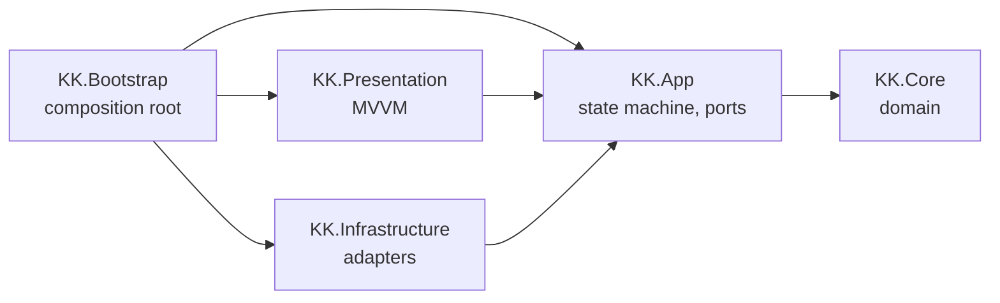
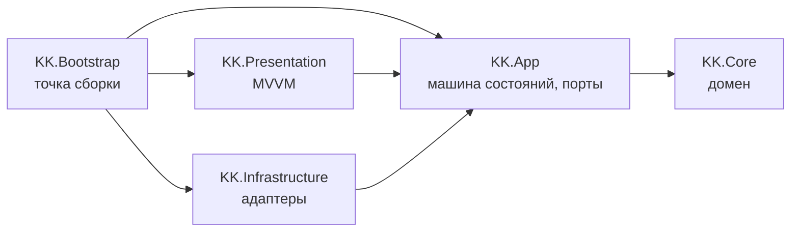

# KKnights Typing Game

A pixel-art typing trainer built in Unity, with a clean layered architecture designed to grow into a full game.


**[English](#english) | [Русский](#russian)**

---

<a id="english"></a>

## Overview

KKnights Typing Game is a typing game: the player types a text character by character and gets their speed, accuracy and number of mistakes. The text is either a random one from a built-in library or a fragment of an article from [kknights.com](https://kknights.com), fetched through the site's JSON API by a regular link.

Version **0.1.0** is the MVP — a training mode for **WebGL and Windows**. The battle scene around the text (characters, health bars) is a visual groundwork: the architecture is designed so that the planned features (site account login, progress saving, leaderboards, multiplayer, combat) can be added without rewriting the core.

## Demo


**[▶ Play in browser on itch.io](https://cocojombruh.itch.io/kknights-typing-game?secret=NOgXZius04YO9UidQ530P6TdTIw)**

## Features

**Gameplay**
- **Blocking input**: the cursor waits for the correct character, there is no Backspace, and every wrong keystroke counts as a separate mistake. Case is strict.
- **Live statistics**: characters per minute, accuracy and mistakes update while typing; the timer starts at the first keystroke.
- **Results screen**: retry the same text, get another text from the same source, or return to the menu.

**Texts**
- **Two sources, chosen in the menu**: a random text from the built-in library (never the same one twice in a row) or an article from kknights.com by its public link, validated before loading.
- **Article fragments made of whole paragraphs** within a configured length (300–600 characters by default) — sentences are never cut in the middle.
- **Text normalization**: typographic quotes, dashes and ellipses become ASCII, line breaks become spaces, characters that can't be typed are removed.
- **Reliable loading**: 15-second timeout, cancellation when leaving the screen, a clear message for each failure reason (no connection, not found, timeout, unknown format) and a Retry button.

**Interface**
- Pixel-art battle scene built from the design mockup: 9-slice frames, pixel fonts, an animated campfire.
- Highlighting of the current character and of mistakes (including a mistake on a space), a segmented progress bar.
- On-screen keyboard that highlights the next key and the Shift of the opposite hand (ЙЦУКЕН and QWERTY).
- Game version in the menu corner; development builds also show the commit hash.

**Engineering**
- **State machine** for the game flow: Menu → Loading → Typing → Results.
- **EditMode tests for every layer** except the composition root — from the domain to real TextMeshPro rendering, including the build tool.
- **Build tool** `KK/Build`: WebGL and Windows profiles, version bump with a CHANGELOG release, build report and a zip for itch.io; also runs from the command line.

## Tech Stack

| Technology | Why it's used |
|---|---|
| **Unity 6** (6000.6), **URP 2D** | Engine and rendering, one codebase for WebGL and Windows |
| **C#**, assembly definitions | Code split into layer assemblies; the compiler enforces dependency direction |
| **UniTask** | async/await integrated into the Unity PlayerLoop; works on WebGL where there are no threads |
| **R3** | Reactive properties for ViewModel → View binding |
| **Input System** | Text input through `Keyboard.onTextInput`, which respects the OS keyboard layout |
| **TextMeshPro** | Text rendering; static font atlases with Cyrillic |
| **UnityWebRequest** / **HttpClient** | Loading articles: the first in the browser, the second in the Editor and on Windows (see the decisions below) |
| **Newtonsoft.Json** | Parsing the kknights.com API responses |
| **Unity Test Framework** (NUnit) | EditMode tests; `InputTestFixture` emulates keyboards |
| **Build Profiles** | Build configurations used by the `KK/Build` tool |

## Architecture

The code follows **Clean Architecture**: it is split into assembly definitions (asmdef), one per layer. Dependencies point inwards, toward the domain.



*An arrow means "references". `KK.Core` is also referenced directly by the outer layers.*

| Layer | Responsibility | Rules |
|---|---|---|
| `KK.Core` | Domain: typing session, keystroke log, statistics, text normalization, article fragment selection | No Unity references (`noEngineReferences: true`), synchronous pure C# |
| `KK.App` | Game state machine and ports: screens, text providers, input, clock, logger | No Unity API |
| `KK.Infrastructure` | Port implementations: text providers and library, site API parser, network loaders with a timeout, keyboard input, clock, logger | Doesn't know about Presentation |
| `KK.Presentation` | MVVM: views of the menu, loading, typing and results screens, `TypingViewModel`, formatters | Doesn't know about Infrastructure |
| `KK.Bootstrap` | Composition root: `GameEntryPoint`, text provider factory | The only assembly that knows all the others |
| `KK.Build.Editor` | Build tool: window, CLI, version and CHANGELOG handling | Editor only, doesn't reference game assemblies |

**Execution flow.** `GameEntryPoint` assembles the objects, registers the states and enters `MenuState`; it makes no game decisions itself. The menu passes the player's choice of a text source to `LoadingState`, which loads and normalizes the text; `TypingState` creates the input for the round and hands a `TypingSession` to the typing screen; when the session completes, `ResultsState` shows the result and leads back to typing, loading or the menu. Each state talks to its screen only through a port interface, so the whole flow is tested on fake screens.

## Key Design Decisions

- **Layered asmdef assemblies.** Dependency rules are enforced by the compiler rather than by convention: the domain physically can't reference `UnityEngine`. The core stays testable and can later be reused on a server for multiplayer.
- **Game flow as a state machine in the application layer.** Each state owns what it created in `Enter` and releases it in `Exit` (cancels loading, ends the round, disposes of input). Screens are ports (`IMenuScreen`, `ITypingScreen`, …), so the flow doesn't depend on Unity UI and is covered by tests.
- **Ports live in the layer that uses them.** Interfaces are declared in `KK.App`, implementations live in `KK.Infrastructure`. A new text source is a new value in `TextSourceKind` plus one factory branch, with no changes to the core.
- **The domain doesn't know about time.** `TypingSession.TryType` receives the timestamp from an `IClock` port, and all metrics are derived from a full keystroke log. The domain stays deterministic, and new metrics (per-key errors, speed over time) don't touch the input logic.
- **Network loading chosen per platform.** kknights.com accepts only TLS 1.3, which Unity's own TLS stack doesn't support, so the Editor and Windows use `HttpClient`. In WebGL there are no sockets, but the browser does the handshake itself, so `UnityWebRequest` works. Both hide behind `IWebTextLoader`; the article provider doesn't know which one it got.
- **Load errors are part of the port contract.** Loaders translate their own exceptions into `TextLoadException` with a reason (`Network`, `NotFound`, `Timeout`, `BadFormat`), so the game flow and UI don't depend on the network technology. The timeout is a decorator with a realtime timer that distinguishes its own timeout from an external cancellation.
- **Constraints of WebGL taken into account.** No `Task.Run`/`Task.Delay`; statistics are refreshed by a `Tick()` call from `Update` instead of R3 timers, which run on threads without the `R3.Unity` integration.
- **Text and fonts agree with each other.** With blocking input, a character the player can't type would stop them forever, so the normalizer keeps a whitelist of characters. The fonts are static TMP atlases containing exactly that whitelist — no missing glyphs; a test fails if they diverge.

## Project Structure

```
Assets/Scripts/
├── Core/             KK.Core — domain
│   ├── Typing/       TypingSession, Keystroke, StatsCalculator, TypingResult
│   └── Texts/        TextNormalizer, TextFragmentSelector
├── App/              KK.App
│   ├── Flow/         GameStateMachine, Menu/Loading/Typing/ResultsState, Screens/ (screen ports)
│   ├── Texts/        TextSource, ITypingTextProvider(Factory), TextLoadException
│   └── Typing/       ITypingInput, ITypingInputFactory
├── Infrastructure/   KK.Infrastructure — adapters
│   ├── Texts/        library and article providers, KKnights/ (link and API parsing)
│   ├── Web/          UnityWebRequest / HttpClient loaders, TimeoutWebTextLoader
│   └── Input/        TextInputHandler
├── Presentation/     KK.Presentation — Menu/, Loading/, Typing/, Results/, Decor/
├── Bootstrap/        KK.Bootstrap — GameEntryPoint, provider factory
└── Build/Editor/     KK.Build.Editor — build tool

Assets/Tests/         one EditMode test assembly per layer + KK.Build.Editor.Tests
Assets/Texts/         TextLibrary.asset — built-in texts
Assets/Art/Battle/    battle scene sprites
```

## Getting Started

**Requirements:** Unity **6000.6.4f1**.

1. Clone the repository and open the folder in Unity Hub. Packages are restored automatically; UniTask and R3 come from the OpenUPM scoped registry.
2. Open `Assets/Scenes/SampleScene.unity` and press **Play**.
3. In the menu, choose a random text or paste a link to a kknights.com article (`https://kknights.com/posts/<slug>`), then start typing.

**Tests:** **Window → General → Test Runner**, the **EditMode** tab, **Run All**. Or from the command line:

```
Unity.exe -batchmode -projectPath . -runTests -testPlatform EditMode -testResults results.xml
```

**Builds:** the **KK → Build** window, or from the command line:

```
Unity.exe -batchmode -quit -projectPath . -executeMethod KK.Build.Editor.BuildCommands.Build -profile WebGL-Release -logFile build.log
```

> In a WebGL build, loading articles from kknights.com additionally requires CORS headers on the site's side.

## Author

**artshest**

- GitHub: [github.com/artshest](https://github.com/artshest)
- Telegram: [@artshest](https://t.me/artshest)
- LinkedIn: [artem-shestakov-unity](https://www.linkedin.com/in/artem-shestakov-unity/)

The project is developed with [Claude Code](https://claude.com/claude-code) as an AI pair programmer — for discussing architecture options, reviewing code and writing tests. Design decisions, their trade-offs and the final code are the author's responsibility; the reasoning behind them is written down in this README.

## License

This project is licensed under the [MIT License](LICENSE).

---

<a id="russian"></a>

## Обзор

KKnights Typing Game — игра-тренажёр слепой печати: игрок посимвольно набирает текст и получает скорость, точность и число ошибок. Текст — случайный из встроенной библиотеки или фрагмент статьи с [kknights.com](https://kknights.com), загруженный через JSON API сайта по обычной ссылке.

Версия **0.1.0** — это MVP: режим тренировки для **WebGL и Windows**. Боевая сцена вокруг текста (персонажи, полоски здоровья) — визуальный задел: архитектура рассчитана на то, чтобы запланированные возможности (вход через аккаунт сайта, сохранение прогресса, лидерборды, мультиплеер, бои) добавлялись без переделки ядра.

## Демо


**[▶ Играть в браузере на itch.io](https://cocojombruh.itch.io/kknights-typing-game?secret=NOgXZius04YO9UidQ530P6TdTIw)**

## Возможности

**Геймплей**
- **Блокирующий ввод**: курсор ждёт правильный символ, Backspace нет, каждое неверное нажатие — отдельная ошибка. Регистр строгий.
- **Живая статистика**: знаки в минуту, точность и ошибки обновляются во время набора; время идёт от первого нажатия.
- **Экран результатов**: повторить тот же текст, взять другой текст из того же источника или вернуться в меню.

**Тексты**
- **Два источника на выбор в меню**: случайный текст из встроенной библиотеки (без повтора подряд) или статья с kknights.com по публичной ссылке, которая проверяется до загрузки.
- **Фрагмент статьи из целых абзацев** заданной длины (по умолчанию 300–600 символов) — предложения не обрезаются посередине.
- **Нормализация текста**: типографские кавычки, тире и многоточия приводятся к ASCII, переводы строк становятся пробелами, ненабираемые символы удаляются.
- **Надёжная загрузка**: таймаут 15 секунд, отмена при уходе с экрана, понятное сообщение для каждой причины сбоя (нет связи, не найдено, таймаут, незнакомый формат) и кнопка «Повторить».

**Интерфейс**
- Пиксельная боевая сцена по дизайн-макету: 9-slice рамки, пиксельные шрифты, анимированный костёр.
- Подсветка текущего символа и ошибок (в том числе ошибки на пробеле), сегментированная полоса прогресса.
- Экранная клавиатура подсвечивает следующую клавишу и Shift противоположной руки (ЙЦУКЕН и QWERTY).
- Версия игры в углу меню; в отладочных сборках — ещё и хэш коммита.

**Инженерная часть**
- **Машина состояний** игрового потока: Меню → Загрузка → Набор → Результаты.
- **EditMode-тесты для каждого слоя**, кроме composition root, — от домена до рендеринга на настоящем TextMeshPro, включая тулзу сборок.
- **Тулза сборок** `KK/Build`: профили WebGL и Windows, повышение версии с выпуском CHANGELOG, отчёт о сборке и zip для itch.io; запускается и из командной строки.

## Стек технологий

| Технология | Зачем используется |
|---|---|
| **Unity 6** (6000.6), **URP 2D** | Движок и рендеринг, одна кодовая база для WebGL и Windows |
| **C#**, assembly definitions | Код разделён на сборки по слоям; направление зависимостей проверяет компилятор |
| **UniTask** | async/await, встроенный в PlayerLoop Unity; работает в WebGL, где нет потоков |
| **R3** | Реактивные свойства для связки ViewModel → View |
| **Input System** | Ввод текста через `Keyboard.onTextInput` с учётом раскладки ОС |
| **TextMeshPro** | Рендеринг текста; статические атласы шрифтов с кириллицей |
| **UnityWebRequest** / **HttpClient** | Загрузка статей: первый — в браузере, второй — в редакторе и на Windows (см. решения ниже) |
| **Newtonsoft.Json** | Разбор ответов API kknights.com |
| **Unity Test Framework** (NUnit) | EditMode-тесты; `InputTestFixture` эмулирует клавиатуры |
| **Build Profiles** | Конфигурации сборок, с которыми работает тулза `KK/Build` |

## Архитектура

Код построен по принципам **Clean Architecture** и разделён на сборки (asmdef), по одной на слой. Зависимости направлены внутрь, к домену.



*Стрелка означает «ссылается на». На `KK.Core` напрямую ссылаются и внешние слои.*

| Слой | Ответственность | Правила |
|---|---|---|
| `KK.Core` | Домен: сессия набора, журнал нажатий, статистика, нормализация текста, выбор фрагмента статьи | Без ссылок на Unity (`noEngineReferences: true`), синхронный чистый C# |
| `KK.App` | Машина состояний игры и порты: экраны, провайдеры текста, ввод, часы, логгер | Без Unity API |
| `KK.Infrastructure` | Реализации портов: провайдеры и библиотека текстов, парсер API сайта, сетевые загрузчики с таймаутом, ввод с клавиатуры, часы, логгер | Не знает о Presentation |
| `KK.Presentation` | MVVM: View экранов меню, загрузки, набора и результатов, `TypingViewModel`, форматтеры | Не знает об Infrastructure |
| `KK.Bootstrap` | Composition root: `GameEntryPoint`, фабрика провайдеров текста | Единственная сборка, знающая все остальные |
| `KK.Build.Editor` | Тулза сборок: окно, CLI, работа с версией и CHANGELOG | Только редактор, не ссылается на игровые сборки |

**Поток выполнения.** `GameEntryPoint` собирает объекты, регистрирует состояния и входит в `MenuState`; решений об игре он не принимает. Меню передаёт выбранный игроком источник текста в `LoadingState`, который загружает и нормализует текст; `TypingState` создаёт ввод на раунд и отдаёт `TypingSession` экрану набора; по завершении сессии `ResultsState` показывает итог и ведёт обратно в набор, загрузку или меню. Каждое состояние общается со своим экраном только через интерфейс-порт, поэтому весь поток протестирован на фейковых экранах.

## Ключевые решения

- **Слоистые asmdef-сборки.** Правила зависимостей обеспечивает компилятор, а не договорённость: домен физически не может сослаться на `UnityEngine`. Ядро остаётся тестируемым, и его можно будет переиспользовать на сервере для мультиплеера.
- **Игровой поток — машина состояний в слое приложения.** Каждое состояние владеет тем, что создало в `Enter`, и освобождает это в `Exit` (отменяет загрузку, завершает раунд, освобождает ввод). Экраны — порты (`IMenuScreen`, `ITypingScreen`, …), поэтому поток не зависит от Unity UI и покрыт тестами.
- **Порты лежат в слое, который их использует.** Интерфейсы объявлены в `KK.App`, реализации — в `KK.Infrastructure`. Новый источник текста — это новое значение в `TextSourceKind` и одна ветка в фабрике, ядро не меняется.
- **Домен не знает о времени.** `TypingSession.TryType` получает время нажатия из порта `IClock`, а все метрики выводятся из полного журнала нажатий. Домен остаётся детерминированным, а новые метрики (ошибки по клавишам, скорость во времени) не затрагивают логику ввода.
- **Загрузка по сети — своя на каждой платформе.** kknights.com принимает только TLS 1.3, который собственный TLS Unity не поддерживает, поэтому в редакторе и на Windows используется `HttpClient`. В WebGL сокетов нет, зато рукопожатие делает сам браузер, и `UnityWebRequest` работает. Обе реализации скрыты за `IWebTextLoader`; провайдер статьи не знает, какую получил.
- **Ошибки загрузки — часть контракта порта.** Загрузчики переводят свои исключения в `TextLoadException` с причиной (`Network`, `NotFound`, `Timeout`, `BadFormat`), поэтому игровой поток и UI не зависят от сетевой технологии. Таймаут — декоратор с таймером реального времени, который отличает свой таймаут от внешней отмены.
- **Учтены ограничения WebGL.** Нет `Task.Run`/`Task.Delay`; статистика пересчитывается вызовом `Tick()` из `Update`, а не таймерами R3, которые без интеграции `R3.Unity` работают на потоках.
- **Текст и шрифты согласованы.** При блокирующем вводе символ, который игрок не может набрать, остановил бы его навсегда, поэтому нормализатор пропускает только белый список символов. Шрифты — статические атласы TMP ровно из этого списка: пропущенных глифов нет, а если список и атласы разойдутся, упадёт тест.

## Структура проекта

```
Assets/Scripts/
├── Core/             KK.Core — домен
│   ├── Typing/       TypingSession, Keystroke, StatsCalculator, TypingResult
│   └── Texts/        TextNormalizer, TextFragmentSelector
├── App/              KK.App
│   ├── Flow/         GameStateMachine, Menu/Loading/Typing/ResultsState, Screens/ (порты экранов)
│   ├── Texts/        TextSource, ITypingTextProvider(Factory), TextLoadException
│   └── Typing/       ITypingInput, ITypingInputFactory
├── Infrastructure/   KK.Infrastructure — адаптеры
│   ├── Texts/        провайдеры библиотеки и статьи, KKnights/ (разбор ссылки и API)
│   ├── Web/          загрузчики UnityWebRequest / HttpClient, TimeoutWebTextLoader
│   └── Input/        TextInputHandler
├── Presentation/     KK.Presentation — Menu/, Loading/, Typing/, Results/, Decor/
├── Bootstrap/        KK.Bootstrap — GameEntryPoint, фабрика провайдеров
└── Build/Editor/     KK.Build.Editor — тулза сборок

Assets/Tests/         по тестовой EditMode-сборке на слой + KK.Build.Editor.Tests
Assets/Texts/         TextLibrary.asset — встроенные тексты
Assets/Art/Battle/    спрайты боевой сцены
```

## Запуск

**Требования:** Unity **6000.6.4f1**.

1. Клонируйте репозиторий и откройте папку через Unity Hub. Пакеты восстановятся автоматически, UniTask и R3 подтягиваются из scoped registry OpenUPM.
2. Откройте `Assets/Scenes/SampleScene.unity` и нажмите **Play**.
3. В меню выберите случайный текст или вставьте ссылку на статью kknights.com (`https://kknights.com/posts/<slug>`) и начинайте печатать.

**Тесты:** **Window → General → Test Runner**, вкладка **EditMode**, **Run All**. Или из командной строки:

```
Unity.exe -batchmode -projectPath . -runTests -testPlatform EditMode -testResults results.xml
```

**Сборки:** окно **KK → Build** или из командной строки:

```
Unity.exe -batchmode -quit -projectPath . -executeMethod KK.Build.Editor.BuildCommands.Build -profile WebGL-Release -logFile build.log
```

> В WebGL-сборке загрузка статей с kknights.com дополнительно требует CORS-заголовков на стороне сайта.

## Автор

**artshest**

- GitHub: [github.com/artshest](https://github.com/artshest)
- Telegram: [@artshest](https://t.me/artshest)
- LinkedIn: [artem-shestakov-unity](https://www.linkedin.com/in/artem-shestakov-unity/)

Проект разрабатывается с помощью [Claude Code](https://claude.com/claude-code) в роли AI-напарника по программированию — для обсуждения вариантов архитектуры, ревью кода и написания тестов. Проектные решения, их компромиссы и итоговый код — ответственность автора; обоснования записаны в этом README.

## Лицензия

Проект распространяется по лицензии [MIT](LICENSE).
